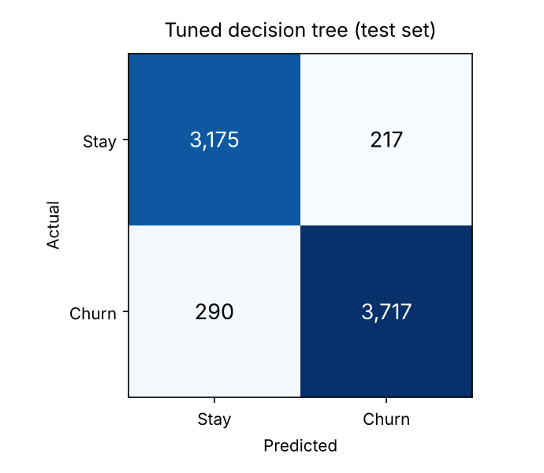
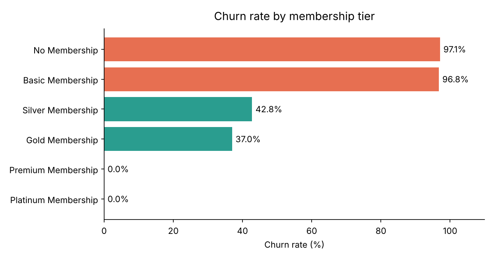

# Customer Churn Analysis and Prediction

End-to-end analysis of why customers leave an e-commerce business, and a decision tree model that predicts who is about to churn.

> Group project for *Data Science Programming (D7054E)*, Luleå University of Technology, March 2024.

## Highlights

- **93% accuracy** on held-out customers with a tuned decision tree (precision 0.94, sensitivity 0.93, specificity 0.94).
- **Production-style preprocessing:** custom scikit-learn transformers for outliers, ordinal encoding and value cleanup, combined in a single `Pipeline` with `ColumnTransformer`.
- **Actionable insights:** membership tier and transaction value turned out to be the strongest churn signals.

## Business problem

"Burbie" is a young e-commerce company that wants to understand its customers and spot churn risks early, so it can act before they leave with offers, better service or personalised deals. Losing a long-standing, high-spending customer is far more expensive than keeping one.

## Data

A public Kaggle dataset of about 37,000 customers and 23 features, stored in [`data/churn.csv`](data/churn.csv):

- **Demographics:** age, gender, region
- **Account:** membership tier, joining date, referral
- **Behaviour:** days since last login, average time spent, login frequency, average transaction value, wallet points
- **Experience:** offer preferences, past complaints and their status, feedback
- **Target:** `churn_risk_score` (1 = churned, 0 = stayed), about 54% / 46%

## Approach

**1. Exploration and cleaning**
- Grouped columns into numerical, categorical, binary and special-handling types.
- Fixed data-quality issues: `"Error"` values in login frequency became missing values, and `"unknown"` categories were standardised to `"Unspecified"`.
- Found impossible values (negative wallet points, `-999` days since login) and flagged extreme outliers with IQR fences.
- Explored every feature with histograms, box plots, pie and bar charts (Plotly, Seaborn, Matplotlib).

**2. Modelling**
- Built custom transformers (`OutlierTrans`, `MakeOrdinal`, `ReplaceVals`) on `BaseEstimator` and `TransformerMixin`.
- Combined imputation, scaling and one-hot encoding with `ColumnTransformer`, then a `DecisionTreeClassifier`, in one pipeline.
- Tuned maximum depth and minimum leaf size with `RandomizedSearchCV`.

## Results

| Model | Accuracy | Sensitivity | Specificity | Precision |
|---|---|---|---|---|
| Decision tree (default) | 0.90 | 0.92 | 0.88 | 0.90 |
| **Decision tree (tuned)** | **0.93** | **0.93** | **0.94** | **0.94** |



Of 4,007 customers who actually churned, the model caught 3,717 and missed 290.

## Key insights



- **Membership is the clearest signal.** Customers with no membership or a basic one churn about 97% of the time, while Premium and Platinum members never churned.
- **High spenders stay.** No customer with an average transaction value above 50,000 churned, whatever their age, login habits or wallet points.
- **Poor experiences hurt across the board.** Customers giving negative feedback on service, product quality, website performance or too many ads churned at about 63–65%.

**What the business should do:** promote and strengthen paid membership tiers, build retention programmes around high-value customers, and fix the most-reported experience problems.

## Ethics

The data includes age, gender, region and a customer ID, which raises questions about re-identification, consent, and the risk of a model treating groups unfairly. Any real deployment in Sweden would need GDPR compliance, bias checks across demographic groups, and care that a high churn score never leads to customers being denied service.

## Repository structure

```
├── main.py                       # command-line entry point
├── churn/
│   ├── data.py                   # loading, cleaning, column groups, IQR fences
│   ├── transformers.py           # OutlierTrans, MakeOrdinal, ReplaceVals
│   ├── model.py                  # pipeline, decision tree, randomized search, evaluation
│   └── eda.py                    # summary tables and figures
├── tests/                        # pytest smoke tests
├── data/
│   └── churn.csv                 # dataset (Kaggle)
└── assets/                       # figures used in this README
```

## Running it (VS Code / Python)

```bash
python -m venv .venv
source .venv/bin/activate        # Windows: .venv\Scripts\activate
pip install -r requirements.txt

python main.py eda                # tables in the console, figures in outputs/eda/
python main.py train              # baseline + tuned tree, confusion matrix, saves models/churn_tree.joblib
python main.py predict --input data/churn.csv --output outputs/predictions.csv
```

In VS Code, open the folder, select the `.venv` interpreter and use the **Run and Debug** panel (`.vscode/launch.json` has a configuration for each command). `pytest` runs the smoke tests.

## Team

**Aamer Barood** and Hind Dafallah.
